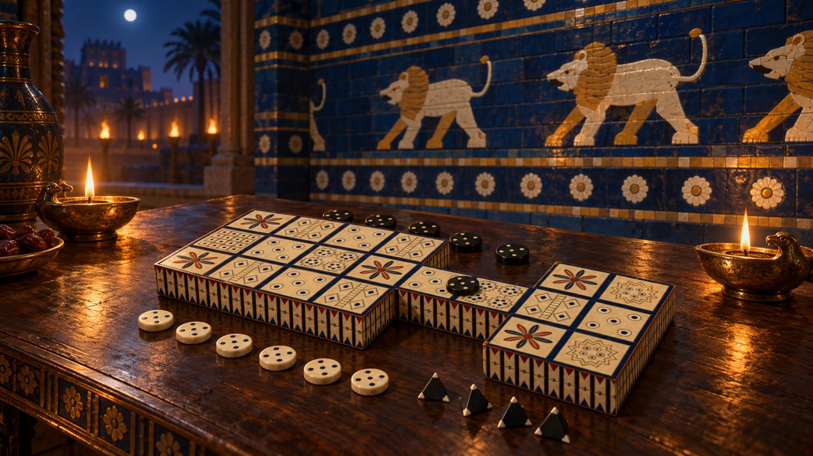
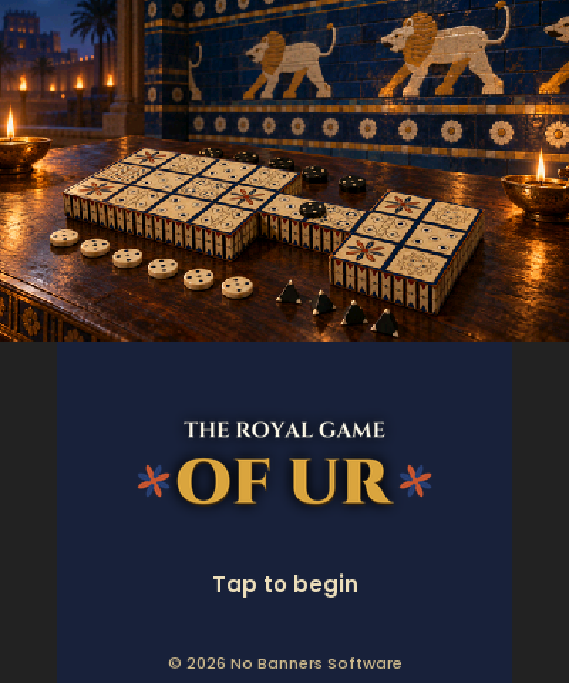
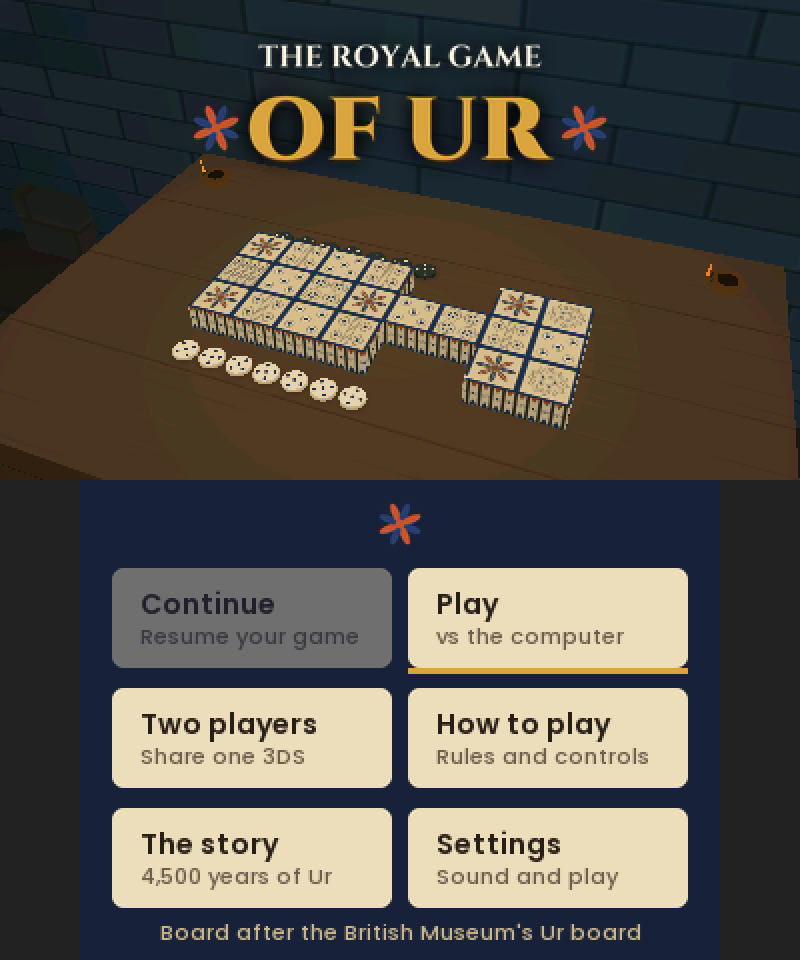
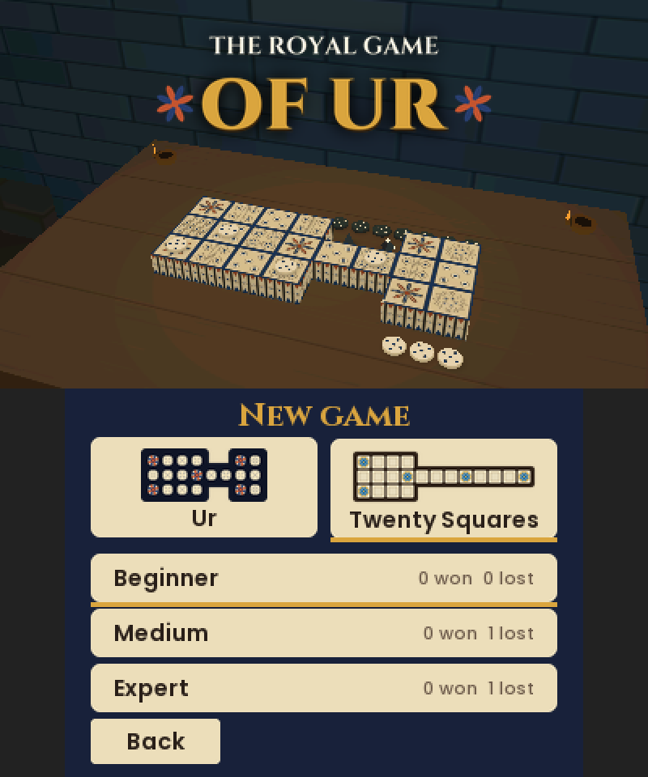
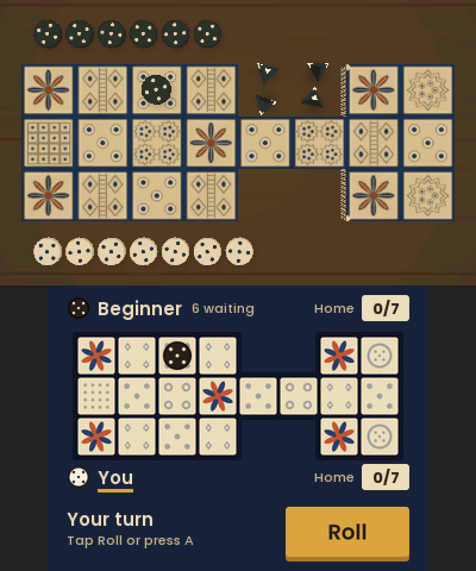
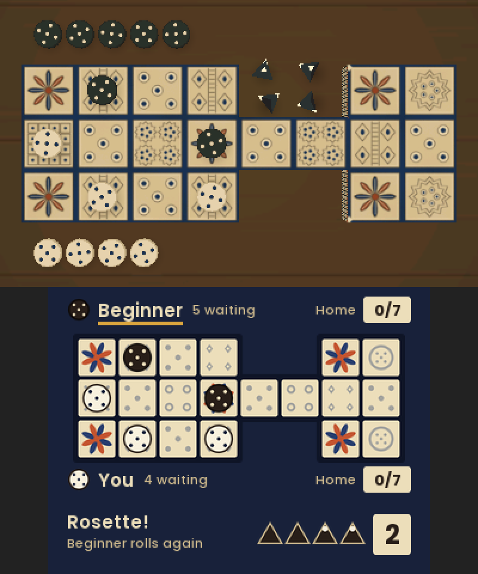
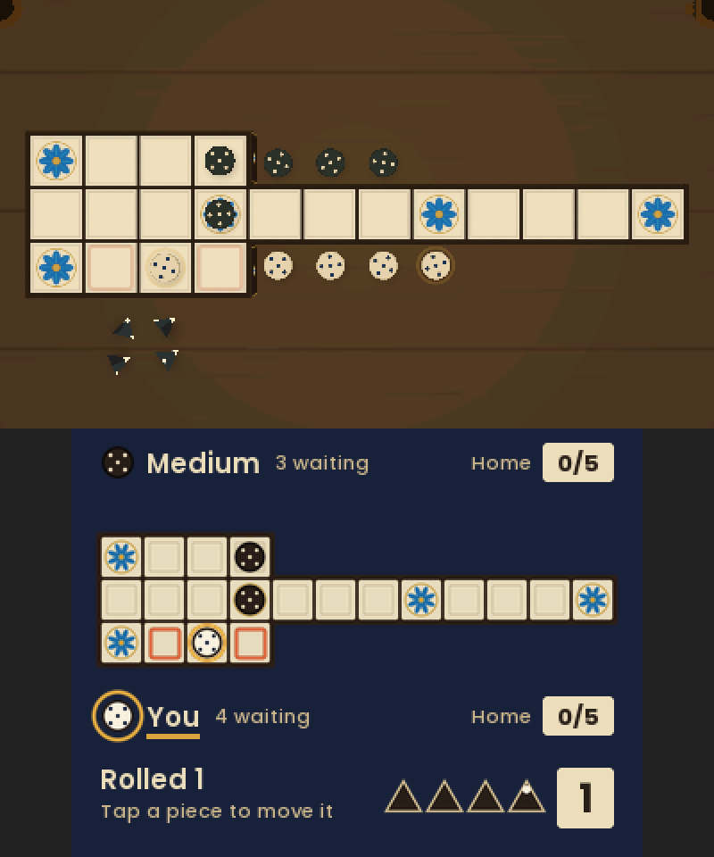
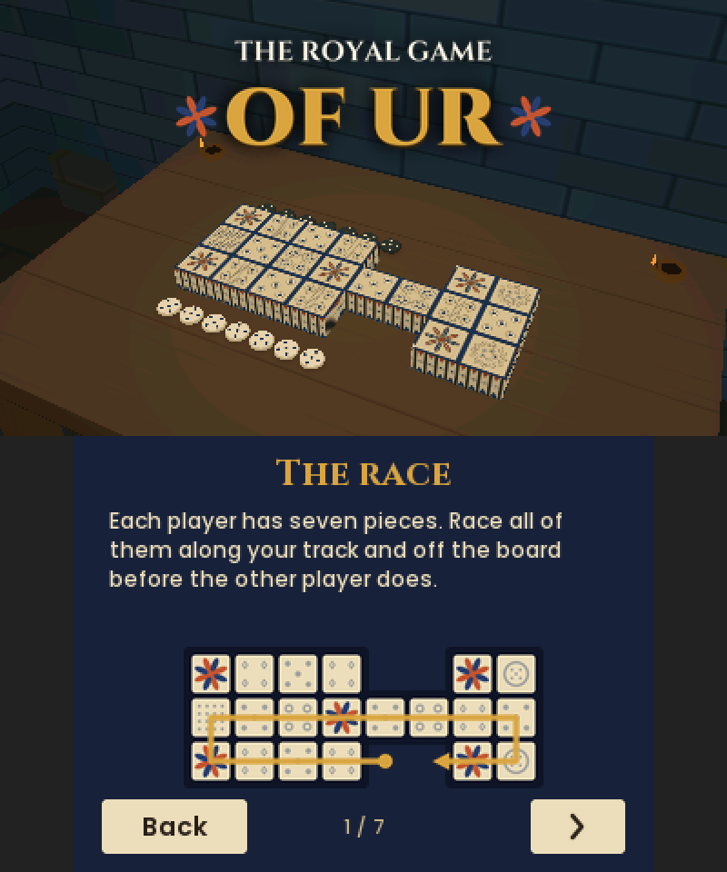
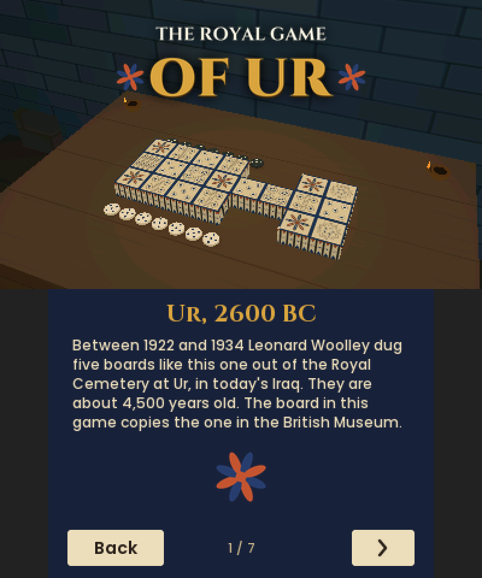
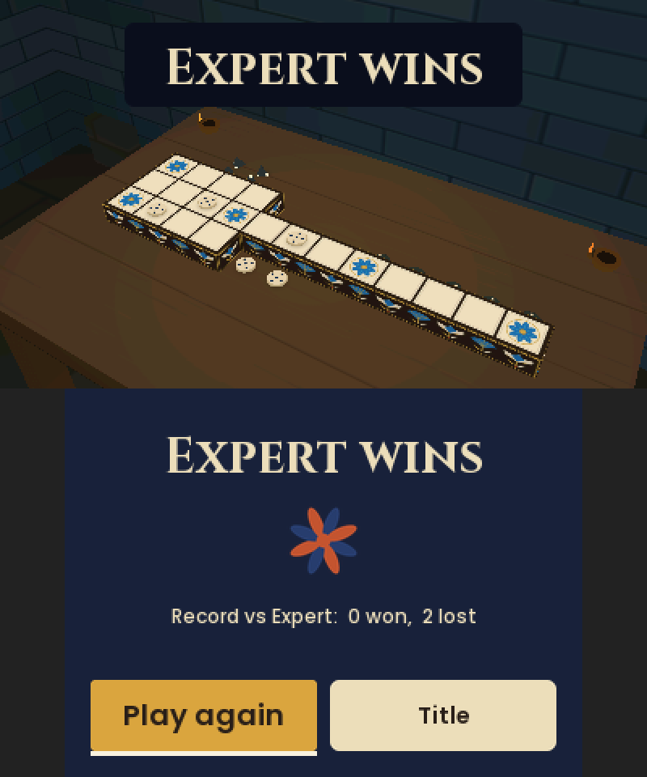

# The Royal Game of Ur (Nintendo 3DS)

A 4,500-year-old race game from ancient Mesopotamia, on the Nintendo 3DS, played on a carved board
in stereoscopic 3D. It has Irving Finkel's rules,
three computer opponents, two-player pass-and-play, and a second board from the game's later
Egyptian life.

Homebrew by No Banners Software, written in C with libctru, citro3d and citro2d.

## Features

- **Two boards.** The classic Ur board, modelled on the one in the British Museum, and the later
  "Twenty Squares" board in an Egyptian style, with its long arm and a rosette on every fourth square.
- **Finkel rules**, the version most people play today, read from a Babylonian tablet of 177 BC.
  Every rule is cross-checked move by move against [RoyalUr.net](https://royalur.net)'s own library.
- **Three opponents:** Beginner, Medium and Expert. Expert looks ahead with expectiminimax, up to
  100,000 positions per move.
- **Two players** on one 3DS.
- **Stereo 3D top screen.** The board is shown straight from above during play, and the lamp-lit
  Babylonian room in the menus. The bottom screen holds a touch map of the board.
- **How to play** and **The story**: illustrated pages on the rules and the game's 4,500-year history.
- **Fortunes from the tablet** appear when you land on a rosette.
- **Saves every turn**, with Continue from the title screen and win/loss records for each board and opponent.
- Sound effects and a lyre-and-drum music loop, both switchable in Settings, plus an optional auto-move
  when only one move is legal.

## Screenshots

Each image shows the top screen (stereo 3D) above the bottom touch screen.

| | | |
|:---:|:---:|:---:|
|  |  |  |
| Splash | Title, in the Babylonian room | Choose a board and an opponent |
|  |  |  |
| Your turn on the Ur board | Landing on a rosette | The Egyptian Twenty Squares board |
|  |  |  |
| How to play | The story | End of a game |

## How to play

Each player races their pieces along their own track and off the far end. The first to bear off
every piece wins.

- **Dice.** Throw four pyramid dice. Each has two marked tips, and the number of marked tips facing up
  is your move, from 0 to 4. A 0 means no move, and 2 comes up most often.
- **Moving.** Move one piece exactly that many squares: either a new piece onto the board, or one
  already on it. You can't land on your own piece, and bearing off needs the exact number.
- **Captures.** The middle row is shared. Land on an enemy piece there and it goes back to the start.
- **Rosettes.** Land on a rosette and you throw again. A rosette in the shared row is safe: a piece on
  it can't be captured, and the other player can't land on it.

| | Ur board | Twenty Squares board |
|---|---|---|
| Pieces per side | 7 | 5 |
| Track | 14 squares: 4 of your own, 8 shared, 2 of your own | 16 squares: 4 of your own, then the whole 12-square middle row, shared |
| Rosettes | 3 on your track; the shared one is safe | Every 4th square; the 3 in the shared row are safe |

The Twenty Squares rules match RoyalUr's "Aseb" preset. The 177 BC tablet names its five pieces
Swallow, Storm-bird, Raven, Rooster and Eagle.

### Controls

- **Stylus:** tap Roll, then tap a ringed piece or its outlined square. Tap your name row to bring
  in a new piece, and the Home box to bear one off.
- **Buttons:** A rolls, the D-pad picks a move, A plays it. START pauses.
- **Debug:** SELECT saves both screens to `sdmc:/3ds/ur-3ds/shots/`; SELECT+R shows frame times.

## Installing on a 3DS

You need a 3DS with custom firmware (Luma3DS). Build the game (see below), then either:

- **CIA:** copy `ur-3ds.cia` to the SD card and install it with FBI. It appears on the HOME Menu as
  "Royal Game of Ur" (product code CTR-H-URGM).
- **3DSX:** copy `ur-3ds.3dsx` to `sdmc:/3ds/` and start it from the Homebrew Launcher.

Sound needs `sdmc:/3ds/dspfirm.cdc`, which you dump with DSP1. Settings, records and the game in
progress are saved in `sdmc:/3ds/ur-3ds/`.

> **Status:** the game is complete and tested end to end in the Azahar emulator, but it hasn't been
> run on real hardware yet. Frame rate and Expert's thinking time on an original 3DS are still
> unmeasured.

## Building

You need [devkitPro](https://devkitpro.org) at `/opt/devkitpro` (devkitARM, libctru, citro3d,
citro2d, tex3ds, picasso), Python 3 with Pillow and numpy, and the Cinzel and Poppins fonts
(SIL OFL, from Google Fonts) to rebuild the glyph sheets.

    export DEVKITPRO=/opt/devkitpro DEVKITARM=/opt/devkitpro/devkitARM
    export PATH=$DEVKITPRO/tools/bin:$DEVKITARM/bin:$PATH
    tools/build_assets.sh       # 3D scene, textures, 2D art, fonts, sounds
    make                        # ur-3ds.3dsx
    tools/make_cia.sh           # ur-3ds.cia (needs makerom and bannertool)

`tools/import_assets.sh [pack]` re-imports the Blender asset pack: the glTF models are converted to
the game's own binary scene format, and static meshes are merged per texture, so the whole room
costs four draw calls. Lighting is baked into the textures.

## Testing

- **Rules and AI:** `make -C host test` builds the engine for the Mac and runs unit tests, 20,000
  fuzzed games per board and the AI tests: about 86 million checks.
- **Cross-check against RoyalUr:** `tools/xcheck/run.sh 1000 1` plays a thousand games per board and
  replays them roll by roll in RoyalUr's MIT Python library (`royalur`), comparing legal moves and
  the position after every roll. Ur uses `Game.create_finkel()` and Twenty Squares uses the stock
  `Game.create_aseb()`; there are currently no mismatches.
- **AI ladder:** `make -C host ladder`. Expert beats Medium 68.5% of games on Ur and 63% on Twenty
  Squares; Medium beats Beginner 98% and 93%.
- **Robot playthrough:** `make clean && make ROBOT=1` builds a robot that plays through the real UI
  at 4x speed, using taps and buttons. It tours every page, tests pause, quit and Continue, and plays
  five games across both boards: each AI level plus a two-player game. It logs to
  `sdmc:/3ds/ur-3ds/robot.txt` and saves screenshots. Run it with `tools/az/azrun.sh` (a silent
  Azahar run in an isolated HOME), then `python3 tools/shots.py`. Run `make clean` again before a
  normal build.

## Project layout

| Path | What |
|---|---|
| `game/` | Rules (`ur_rules`) and AI (`ur_ai`), portable C99, no heap. See [`game/README.md`](game/README.md). |
| `host/` | Mac tests (`make -C host test`) and the AI ladder (`make -C host ladder`) |
| `tools/xcheck/` | Cross-check against RoyalUr's Python library |
| `source/` | 3DS front end: `main.c` (screens, cameras), `play.c` (turn flow, bottom UI), `world.c` (3D pieces, dice, decals), `scene.c` (citro3d), `draw.c` (2D and text), `ai_worker.c` (AI thread), `sfx.c`, `save.c`, `pages.c` (rules and history), `robot.h` (test driver) |
| `assets/` | The Blender asset pack: glTF models, textures, board layouts, dice scoring |
| `gfx/` | Generated 2D art and glyph sheets for tex3ds |
| `tools/art/` | Code-drawn 2D art, font baker and theme colours (`common.py`) |
| `tools/audio/make_sfx.py` | Synthesised sound effects and the lyre music loop |
| `tools/az/` | Azahar runner for silent emulator tests |
| `design/` | Design comps, key art and the Twenty Squares board brief |
| `docs/screenshots/` | Images used in this README |

## Credits

- **Rules:** Irving Finkel of the British Museum, who read the rules from tablet BM 33333B, copied
  by the scribe Itti-Marduk-balatu in Babylon in 177 BC.
- **Rules reference:** [RoyalUr.net](https://royalur.net) and its MIT-licensed `royalur` Python
  library, used as the test oracle. Nothing from it ships in the game.
- **3D models:** the board, pieces, dice, the Babylonian room and the Egyptian Twenty Squares board
  were modelled in Blender for this game.
- **Key art:** generated with GPT Image 2.
- **Fonts:** Cinzel and Poppins, both under the SIL Open Font License, baked into glyph sheets.
- **Toolchain:** devkitPro, libctru, citro3d and citro2d.

© 2026 No Banners Software
